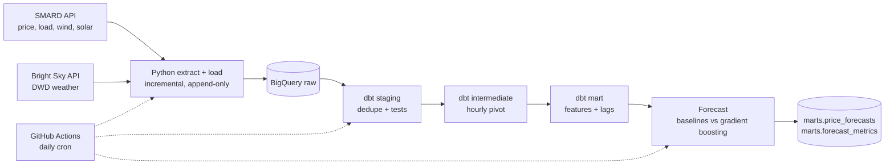
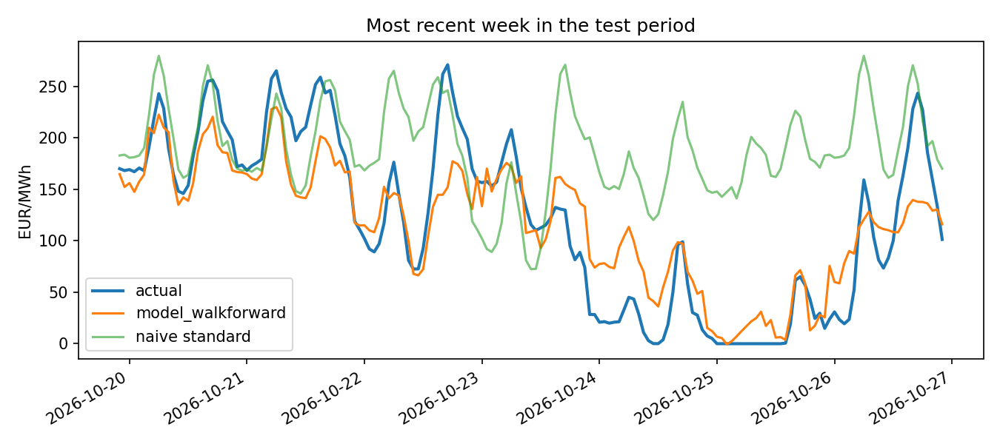

# German Electricity Market: ELT Pipeline and Day-Ahead Price Forecast

## Introduction

Wholesale electricity prices in Germany change every hour and depend on demand, wind and solar output, and the weather. Prices can swing from negative values to several hundred EUR/MWh within days, which makes them difficult to predict and valuable to understand.

This project is an end-to-end data pipeline built on free public data and free-tier cloud services. It collects hourly market data from SMARD (Bundesnetzagentur) and weather data from the German Weather Service (DWD, via Bright Sky), loads it into BigQuery, transforms and tests it with dbt, and runs periodically on GitHub Actions. On top of the modelled data, a machine learning model forecasts the hourly day-ahead price.

## Objective

1. **Engineering:** build an automated ELT pipeline, and learn the nuances of dbt and data orchestration. 
2. **Forecasting:** predict the hourly day-ahead price in the DE-LU bidding zone and measure honestly whether a machine learning model beats simple benchmarks.
3. **Insight:** find out which factors drive forecast accuracy, in particular how much depends on weather information and how performance differs by season.

## Approach in brief

Data is loaded as-is into a `raw` layer in Big Qyer, then cleaned and combined with dbt into one modelled table with one row per hour. Forecasts day-ahead electricity using gradient-boosting model is evaluated on a 12-month data against three naive baselines.
Everything runs on free tiers and is scheduled with GitHub Actions.



## Headline result

Retrained monthly, the model reduced mean absolute error by about 25% compared with using the previous day's price (23.2 vs. 30.9 EUR/MWh). Without weather features, the model performed about the same as that baseline, so most of the improvement comes from weather, mainly wind. The weather used is observed weather, not forecasts, so real-world accuracy would be somewhat lower. See Limitations below.

## Results

| Model                                                  | MAE (EUR/MWh) | RMSE (EUR/MWh) | MAE gain vs. best naive |
| ------------------------------------------------------ | ------------- | -------------- | ----------------------- |
| Naive: same hour yesterday                             | 30.86         | 48.31          | 0                       |
| Naive: same hour last week                             | 39.04         | 59.44          | -26.5                   |
| Naive standard (last week Mon/Sat/Sun, else yesterday) | 33.25         | 52.06          | -7.74                   |
| Gradient boosting, no weather features                 | 31.01         | 45.1           | -0.5                    |
| Gradient boosting, single split                        | 25.56         | 37.98          | 17.17                   |
| Gradient boosting, walk-forward (monthly retraining)   | 23.18         | 35.55          | 24.89                   |



### 1. Google Cloud

1. Create a project and enable the BigQuery API.
2. Create a service account with role **BigQuery Data Editor**, and download a JSON key.

### 2. Local run

```bash
python -m venv .venv && source .venv/bin/activate
pip install -r requirements.txt
cp .env.example .env            # edit GCP_PROJECT, then: source .env
gcloud auth application-default login #or what i did was create a key for user in bigquery and run below command


  $env:GOOGLE_APPLICATION_CREDENTIALS = "path\sa-key.json"
  $env:GCP_PROJECT = "your-project-id"
  $env:BQ_LOCATION = "EU"


python -m ingestion.extract_load --source all --dry-run   # 1. test the APIs, no GCP writes
python -m ingestion.extract_load --source all             # 2. backfill from 2024-01-01
cd dbt && dbt build && cd ..                               # 3. models + tests
python -m ml.forecast                                      # 4. train, evaluate, write results
#   add --no-walk-forward for a faster run
pytest -q                                                  # unit tests

Inspect in Bigquery and ml/artifacts folders
```

### 3. Scheduling on GitHub Actions

Add repository secrets `GCP_PROJECT` (project id) and `GCP_SA_KEY` (full JSON key), then push. The `daily-elt` workflow runs at 05:00 UTC and can be started manually with an optional `start_date` for backfills. GitHub can start scheduled runs late, and pauses scheduled workflows in repositories with no activity for 60 days.

## Project layout

```
ingestion/   extract (SMARD, Bright Sky) and load to BigQuery
dbt/         staging, intermediate, marts, tests, source freshness
ml/          forecast.py: baselines, model, metrics, plots
tests/       pytest unit tests (parsing, incremental logic, leakage-free evaluation)
.github/     daily-elt (schedule) and ci (tests + dbt parse)
```

## Data and attribution

Market data: Bundesnetzagentur | SMARD.de. Weather: Deutscher Wetterdienst via Bright Sky.

## Next steps

Weather forecasts as features, quantile forecasts for price uncertainty, regional weather weighting by installed capacity, a Streamlit dashboard, Airflow or Dagster.
