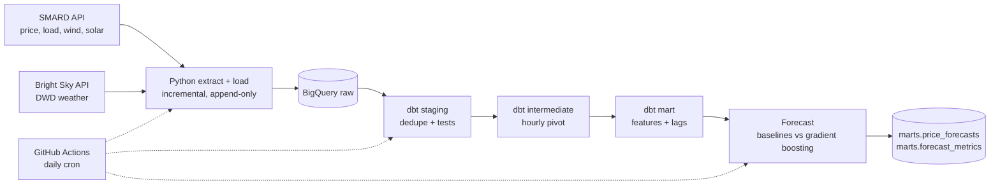

# German Electricity Market: ELT Pipeline and Day-Ahead Price Forecast

A daily ELT pipeline that loads German power market data and weather into BigQuery,
models it with dbt, and forecasts day-ahead electricity prices against naive baselines.
Everything runs on free tiers and is scheduled with GitHub Actions.



## Results

> Fill in after your first full run (`ml/artifacts/results.md` is generated for you).

| Model                                                  | MAE (EUR/MWh) | RMSE (EUR/MWh) | MAE gain vs. standard naive |
| ------------------------------------------------------ | ------------- | -------------- | --------------------------- |
| Naive: same hour yesterday                             |               |                |                             |
| Naive: same hour last week                             |               |                |                             |
| Naive standard (last week Mon/Sat/Sun, else yesterday) |               |                | 0%                          |
| Gradient boosting, no weather features                 |               |                |                             |
| Gradient boosting, single split                        |               |                |                             |
| Gradient boosting, walk-forward (monthly retraining)   |               |                |                             |


Findings to write up: which season is hardest to forecast, how the model behaves around
negative-price hours, and which features matter most (see `feature_importance.csv`).

## Design decisions

- **ELT, not ETL.** Raw data lands untouched in BigQuery; all cleaning happens in dbt, so
  transformations are versioned, tested and re-runnable.
- **Append-only raw layer with a lookback window.** Each run re-fetches the last 48 hours
  because published values can be revised. Duplicates are resolved in `stg_*` by keeping
  the latest `ingested_at` per key. Re-running any day is safe (idempotent), and a dbt
  `unique` test on the surrogate key proves it.
- **Load jobs instead of streaming inserts.** Works in the BigQuery sandbox and is free.
- **Lags via timestamp self-joins, not `LAG()`.** A missing hour cannot silently shift a
  lag onto the wrong timestamp.
- **Time-based split, 12-month test window** so every season is evaluated.
- **Three kinds of comparison.** (1) A standard benchmark from the price-forecasting
  literature (last week's price for Mon/Sat/Sun, yesterday's for Tue-Fri), which is harder to
  beat than plain "yesterday". (2) A weather ablation: the same model without weather
  features. (3) Walk-forward evaluation: the model is retrained at the start of each test
  month on all earlier data, which mimics running it in production. A unit test checks
  that no block is ever trained on data from its own or a later period.
- **Backfill starts in 2024** (`DEFAULT_START`) to skip the 2022 energy-crisis regime. Keep at least
  ~2 years: the model needs history before its 12-month test window.
- **Parallel, polite fetching.** Chunks are fetched with a few worker threads
  (`SMARD_WORKERS`, `WEATHER_WORKERS`). Keep these low; both APIs are free public services.

## Limitations (read before trusting the numbers)

- Observed weather stands in for weather forecasts. A production model would use forecast
  weather available at bidding time. The weather ablation brackets the effect: accuracy
  with real forecasts would fall between the no-weather model and the model with observed
  weather. Report all three numbers rather than only the best.
- Same-day load, wind and solar are deliberately excluded to avoid leakage.
- Three weather points are a crude national proxy; wind and solar output depend on
  regional capacity.
- The script evaluates a back-test and refreshes it daily as data arrives. It does not
  publish tomorrow's forecast, because tomorrow's feature row would require the
  auction result itself.

## Setup

### 1. Google Cloud

1. Create a project and enable the BigQuery API.
2. Attach a billing account and set a **budget alert**. The BigQuery sandbox expires
   tables after 60 days, which would break this pipeline; this project stays well within
   the monthly free tier (1 TB queries, 10 GB storage).
3. Create a service account with roles **BigQuery Data Editor** and **BigQuery Job User**,
   and download a JSON key.

### 2. Local run

```bash
python -m venv .venv && source .venv/bin/activate
pip install -r requirements.txt
cp .env.example .env            # edit GCP_PROJECT, then: source .env
gcloud auth application-default login #or what i did was create a key for user in bigquery and run below command

conda activate energy-elt
conda env config vars set GOOGLE_APPLICATION_CREDENTIALS="path/sa-key.json"
conda env config vars set GCP_PROJECT=project-id
conda env config vars set BQ_LOCATION=EU
conda deactivate
conda activate energy-elt

python -m ingestion.extract_load --source all --dry-run   # 1. test the APIs, no GCP writes
python -m ingestion.extract_load --source all             # 2. backfill from 2024-01-01
cd dbt && dbt build && cd ..                               # 3. models + tests
python -m ml.forecast                                      # 4. train, evaluate, write results
#   add --no-walk-forward for a faster run
pytest -q                                                  # unit tests

Inspect in Bigquery and ml/artifacts folders
```

### 3. Scheduling on GitHub Actions

Add repository secrets `GCP_PROJECT` (project id) and `GCP_SA_KEY` (full JSON key), then
push. The `daily-elt` workflow runs at 05:00 UTC and can be started manually with an
optional `start_date` for backfills. GitHub can start scheduled runs late, and pauses
scheduled workflows in repositories with no activity for 60 days.

## Speeding up or avoiding the backfill

BigQuery cannot call the SMARD or Bright Sky APIs itself, so extraction always runs outside
it. Only the first backfill is slow; daily runs fetch a few days of data.

- **Run the backfill in the cloud:** Actions tab, `daily-elt`, Run workflow, set `start_date`.
  Your laptop does not need to stay on.
- **Shorten it:** set `DEFAULT_START` to a later date, or tune the worker counts.
- **Load data by hand:** export CSVs, then upload them yourself.

```bash
python -m ingestion.extract_load --source all --dry-run --export-dir out
bq mk --location=EU raw
bq load --source_format=CSV --skip_leading_rows=1 raw.smard_raw out/smard_raw.csv \
  series:STRING,ts:TIMESTAMP,value:FLOAT,ingested_at:TIMESTAMP
bq load --source_format=CSV --skip_leading_rows=1 raw.weather_raw out/weather_raw.csv \
  location:STRING,ts:TIMESTAMP,temperature_c:FLOAT,wind_speed_kmh:FLOAT,sunshine_min:FLOAT,cloud_cover_pct:FLOAT,precipitation_mm:FLOAT,ingested_at:TIMESTAMP
```

In the console instead: BigQuery Studio, dataset `raw`, Create table, Source "Upload",
pick the CSV, and enter the same columns as the schema. Table names must be `smard_raw`
and `weather_raw`, because dbt reads them as sources.

## Project layout

```
ingestion/   extract (SMARD, Bright Sky) and load to BigQuery
dbt/         staging, intermediate, marts, tests, source freshness
ml/          forecast.py: baselines, model, metrics, plots
tests/       pytest unit tests (parsing, incremental logic, leakage-free evaluation)
.github/     daily-elt (schedule) and ci (tests + dbt parse)
```

## Data and attribution

Market data: Bundesnetzagentur | SMARD.de. Weather: Deutscher Wetterdienst via Bright Sky.

## Next steps

Weather forecasts as features, quantile forecasts for price uncertainty, regional
weather weighting by installed capacity, a Streamlit dashboard, Airflow or Dagster.
